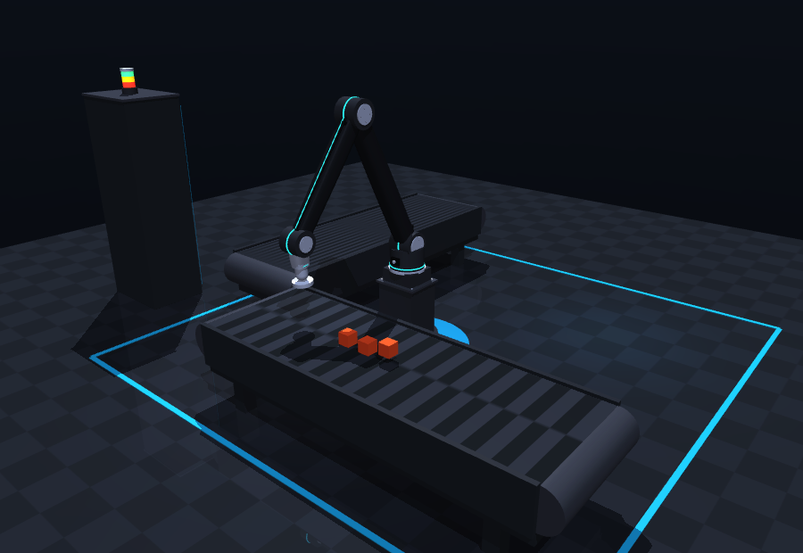
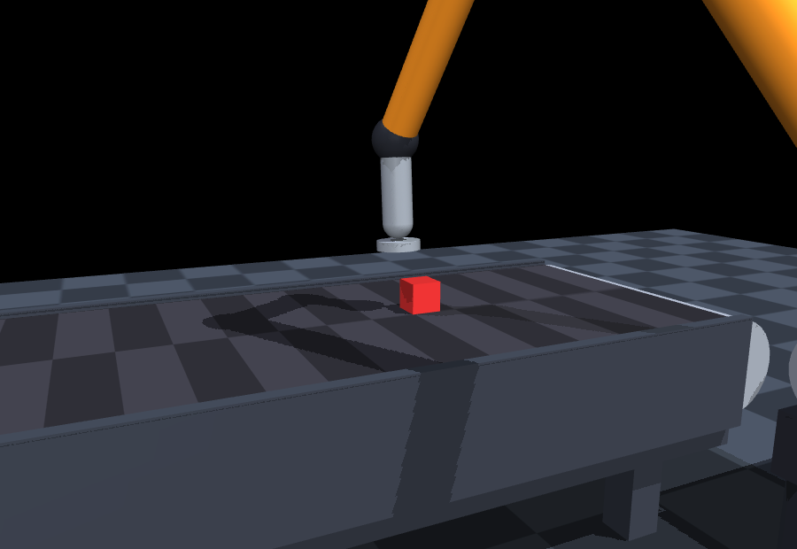
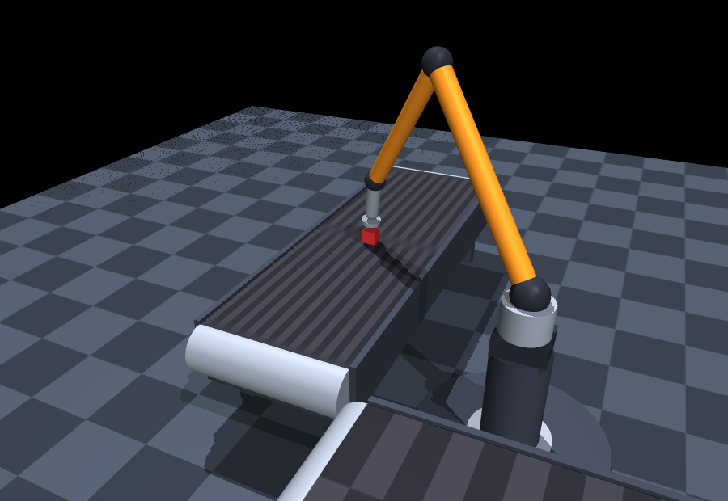
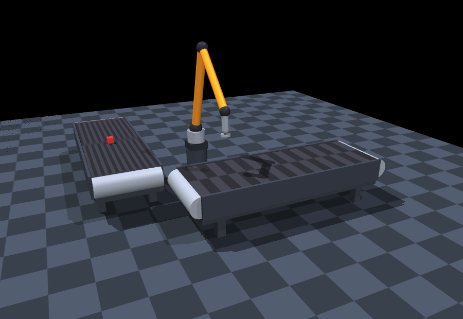
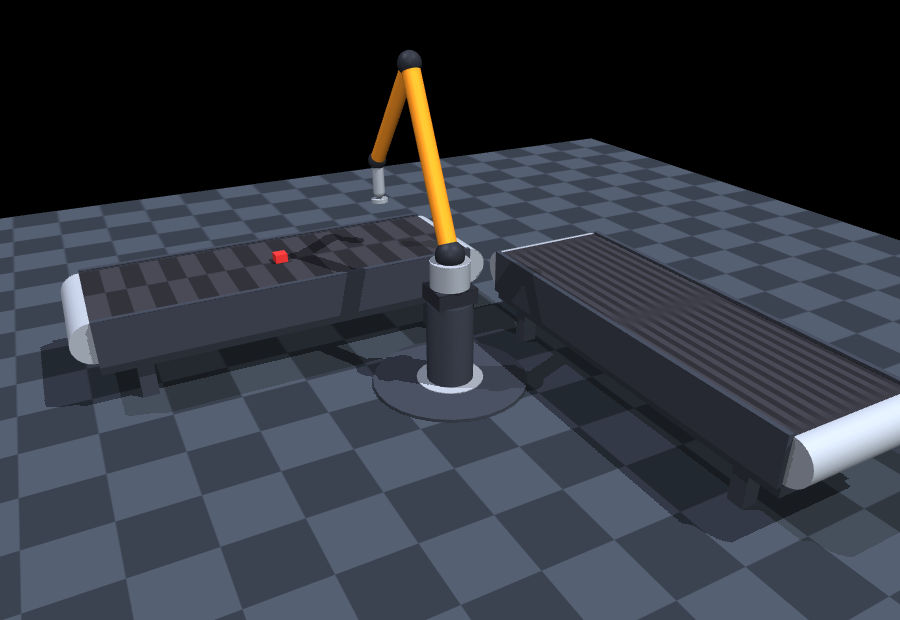

# MuJoCo 机械臂抓取放置（双传送带场景 + PPO 三模型接力）

基于 **MuJoCo 3.x + Gymnasium + Stable-Baselines3 (PPO)** 的机械臂抓取放置项目：
在 L 型双传送带场景中用 4 自由度机械臂完成「取料 → 下抓 → 抬起 → 转移 → 放料 → 回原位」全流程。



## 一个回合的阶段截图

| ① 取料 | ② 下抓 | ③ 抬起 |
|:---:|:---:|:---:|
|  |  |  |

| ④ 转移 | ⑤ 放料（需静止） | ⑥ 回原位 |
|:---:|:---:|:---:|
|  |  |  |

<details>
<summary>训练场景（无贴图，渲染更快）</summary>



</details>

## 结果

| 环节 | 负责模型 | 判定阈值 | 实测成功率 |
|---|---|---|---|
| phase 1 取料 / phase 2 下抓 | `ppo_arm_reach.zip` | dist 3cm / angle 0.98 / 静止 1 步 | 150/150 |
| phase 3 抬起（脚本原语）+ phase 4 转移 + phase 5 放料（需静止） | `saves/phase34_retract.zip` | dist 5cm / angle 0.945 | 100/100 |
| phase 6 回到初始位置 | `saves/phase6_home.zip` | 关节偏差 < 0.15 rad | 100/100 |
| **全流程接力** | 三个模型 | 同上 | **100/100（平均约 150 步）** |

## 环境设计

- **状态** 18 维：4 关节角 + 4 关节速度 + 末端 3D 位置 + 目标 3D 位置 + 相对位移 3D + 当前阶段
- **动作** 4 维：`ctrl = home_ctrl + action * ctrl_scale`，`ctrl_scale = [3, 1, 1, 1]`
- **物理**：每个控制步 `mj_step(..., nstep=5)`，单回合上限 250 步

### 六个阶段

1. **phase 1 取料**：到方块上方 15 cm
2. **phase 2 下抓**：下压到方块上方约 6 cm（末端必须高于方块顶面 5 cm，避免圆盘嵌进方块）
3. **phase 3 抬起**：由**确定性控制器**执行（闭环抬升到方块上方约 9 cm），不由 RL 学习
4. **phase 4 转移**：到中间姿态 `(0.42, 0.27, 0.85)`
5. **phase 5 放料**：到放料点 `(0.65, -0.45, 0.435)`，**要求到位且静止**才判定完成
6. **phase 6 回原位**：回到初始关节配置（判据为关节角偏差 < 0.15 rad）

### 方块（mocap 运动学体）

方块是 `mocap="true"` 的运动学体，位置由 `data.mocap_pos` 控制：

- phase 2 成功 → **锁定**：方块中心始终位于末端下方 6 cm（方块顶面离圆盘约 1 cm），姿态保持竖直；
- phase 5 成功 → **解锁**：方块停在原地；
- 方块不参与碰撞（`contype=0`），避免运动学体反向推挤机械臂。

### 动作平滑

控制端低通滤波 + 阶段切换强平滑，用于消除交接处的"勾一下"动作：

```python
alpha = smooth_alpha                       # 默认 0（训练时关闭）
if phase_entry_steps > 0:                  # 阶段切换后 6 步
    alpha = max(alpha, 0.85)
action = alpha * prev_cmd + (1 - alpha) * action
```

实测 phase 4 最大关节加速度由 2098 rad/s² 降至 1484 rad/s²（−29%），成功率不变。

## 目录结构

```
scene_magnet/
├── envs/
│   ├── arm_env.py        # 主环境：六阶段状态机、mocap 搬运、课程回调
│   ├── phase2.py         # phase 2 训练用交接封装
│   ├── phase34.py        # phase 3-5 训练用交接封装
│   └── phase6.py         # phase 6 训练用交接封装
├── assets/models/
│   ├── train_scene.xml   # 训练场景（无贴图，最快）
│   └── show_scene.xml    # 展示场景（带 mesh）
├── saves/
│   ├── phase1.zip        # 热启动模型（train_phase12.py 使用）
│   ├── phase2.zip        # 旧版 phase 1/2 模型（train_phase34.py 使用）
│   ├── phase34_retract.zip  # model2：phase 3-5
│   └── phase6_home.zip      # model3：phase 6
├── ppo_arm_reach.zip     # model1：phase 1/2（训练产物）
├── train_phase12.py      # 训练 model1
├── train_phase34.py      # 训练 model2（旧版四阶段流程）
├── test.py               # 三模型接力可视化演示 + 批量评测
└── demo.py               # 键盘遥控演示
```

## 安装

```bash
pip install -r requirements.txt
```

依赖：`mujoco>=3.0`、`gymnasium>=0.29`、`stable-baselines3>=2.0`、`torch>=2.0`、`numpy`。

## 运行

```bash
cd scene_magnet
python test.py      # 先无渲染跑 100 局统计，再打开 MuJoCo 窗口逐局演示
python demo.py      # 键盘遥控
```

`test.py` 会自动加载三个模型并接力：`phase < 3` 用 model1，`3 <= phase < 6` 用 model2，`phase >= 6` 用 model3。

## 训练

```bash
cd scene_magnet

# model1：phase 1/2（从 saves/phase1.zip 热启动，24 并行环境，约 3 分钟/1.5M 步）
python train_phase12.py
```

其余两个模型用对应的交接封装训练（`envs/phase34.py`、`envs/phase6.py`），思路是：
训练某个阶段时，先让前序模型跑到该阶段起点，再只训练这一段策略。

关键训练参数（实测在 20 核机器上约 7900 FPS）：

```python
learning_rate=1e-4, n_steps=512, batch_size=1024, n_epochs=5,
policy_kwargs=dict(net_arch=[128, 128]), target_kl=0.02, device="cpu"
# 环境变量 OMP_NUM_THREADS=1 且 torch.set_num_threads(1)
```

## 课程学习

`CurriculumCallback.SCHEDULE` 平滑收紧阈值，终点档为 `dist 0.03 / angle 0.98 / 静止 1`。
注意：阈值必须设置在当前策略能力范围内，否则会卡在局部最优（本项目曾因阈值过松/过严多次失败）。

## 备注

- `tools/` 下是开发过程中的实验与诊断脚本，不属于运行链路；
- 方块是运动学体，因此"撞方块扣分"逻辑默认不生效；
- 修改奖励或阶段结构后需要重新训练对应模型。
