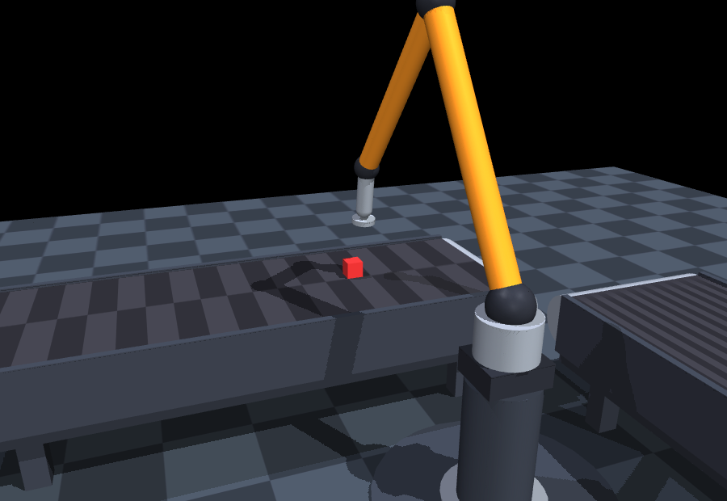
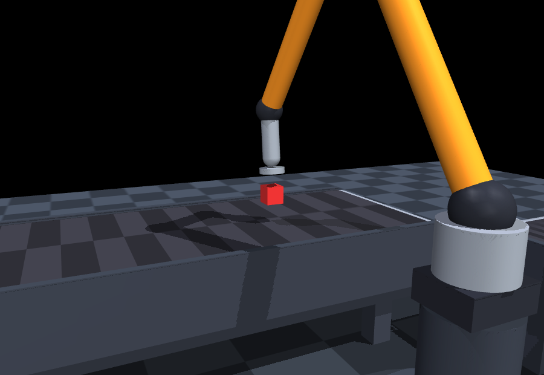
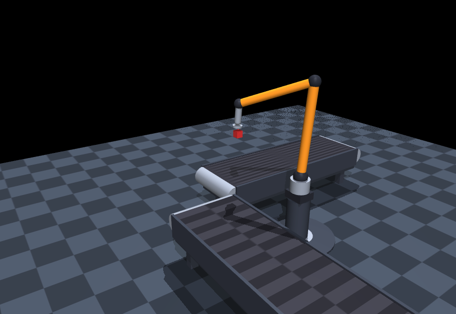

# MuJoCo 双传送带取放（L 型产线 + 4-DOF 磁吸机械臂）

基于 **MuJoCo 3.x + Gymnasium + Stable-Baselines3 (PPO)** 的取放项目：
在 L 型双传送带场景中，4 自由度机械臂从上游来料中抓取方块、搬运到下游带、放料并回到原位。

核心做法是**混合控制**：接近/下抓用 IK 做基准、RL 只学小残差；搬运/放料/回位用关节空间策略；
三个模型按阶段接力，配合**确定性探测的性能门控课程**训练。


| ① 接近 | ② 下抓 | ③ 抬起 |
|:---:|:---:|:---:|
|  |  |  |

| ④ 转移 | ⑤ 放料 | ⑥ 回原位 |
|:---:|:---:|:---:|
|  |  |  |

---

## 结果

三个阶段各训一个策略，按 `phase` 接力：

| 环节 | 模型文件 | 判定阈值 | 实测 |
|---|---|---|---|
| phase 0-2 接近 + 抓取 | `saves/phase1-2.zip` | dist 3.2 cm / angle 0.96 / 连续 2 帧 / rel 0.05 | **六档课程全部 100%**（每档 30 局） |
| phase 3-5 抬起 + 转移 + 放料 | `saves/phase3-5.zip` | dist 3.4 cm / angle 0.965 / 连续 3 帧 | **放料完成 30/30**（确定性 & 随机采样均 100%） |
| phase 6 回原位 | `saves/phase6.zip` | 关节偏差 < 0.15 rad / 连续 3 帧 | **20/20**，最小偏差 0.053 rad |
| **全流程（三模型接力）** | 三者 | — | **100/100**（单方块）<br>连续 10 回合 100%（方块池） |

节拍：抓取 69 步（0.69 s）+ 搬运放料 54 步 + 回位 28 步 ≈ **1.5 s**（不含来料输送）。

---

## 环境设计

### 观测（23 维）

| 维度 | 内容 |
|---|---|
| 0-3 | 4 个关节角 |
| 4-7 | 4 个关节速度 |
| 8-10 | 末端位置 |
| 11-13 | 当前阶段目标位置 |
| 14-16 | 目标 - 末端（相对位移） |
| 17 | 当前 phase |
| 18 | 方块沿带速度 |
| 19-22 | **视觉不确定性占位**（σx, σy, σvx, σvy，接入视觉前恒为 0） |

### 动作（4 维）与混合控制

```python
# phase 1/2：IK 基准 + RL 残差
q_ref = ik(self._target())           # 梯度迭代 5 次，约 200 µs
ctrl  = q_ref + action * 0.02        # 残差 0.02 rad ≈ 末端 1 cm/单位动作

# phase 3-6：关节空间
ctrl  = home_ctrl + action * ctrl_scale      # ctrl_scale = [3, 1, 1, 1]
```

**为什么必须用 IK 基准**：纯关节空间时，yaw 动作 1 单位 = 末端 1.71 m，跟踪 0.2 m/s 需要
0.0012 的动作精度，而策略标准差约 0.08（差 69 倍），相对速度永远学不到阈值内。
换成 IK 基准 + 残差后，`mrel` 从 1.4 降到 0.15，课程从"卡在第 2 档"变成"连过 5 档"。

### 七个阶段

| phase | 内容 | 判定 |
|---|---|---|
| 0 | 等方块从带上走来，手臂保持 home | 方块 x ≥ `arrive_x`（−0.475） |
| 1 | 到方块上方 15 cm | 固定阈值 0.045 / 0.95 |
| 2 | 下压到方块上方 6 cm | 课程阈值 + 相对速度 + 连续帧 |
| 3 | **脚本化抬起**（确定性控制器，不用 RL） | 抬升 18 步 |
| 4 | 转移到 `(0.314, 0.322, 0.78)` | dist 阈值 ×4 + angle > 0.8 |
| 5 | 放料到 `(0.65, −0.45, 0.435)` | 到位 + 连续静止帧 + 关节速度 |
| 6 | 回到初始关节配置 | 关节偏差 < `home_tol` + 连续帧 |

phase 6 的成功**不要求**方块已入篮（`collect_after_place=False`）：回原位是机器人的事，入筐是下游输送的事。

### 传送带 / 方块

- **带 A**：`x ∈ [−1.20, 0.30]`，`y ∈ [0.40, 0.90]`，带面 `z = 0.350`，沿 **+x** 输送，速度 **0.12 m/s**；
- **带 B**：沿 **−y** 输送放料后的方块，0.8 m/s，`y ≤ −1.18` 视为入篮；
- 方块是 **mocap 运动学体**（`contype=0`，不参与碰撞），phase 2 成功后跟随末端下方 6 cm，
  phase 5 成功后交给 B 带；
- 刷新区间（训练默认）：`x ∈ [−0.475, −0.100]` 均匀、`y ∈ [0.570, 0.730]` 均匀；
- 方块池（演示用）：场景里有 `cube_0..cube_9`，定时从带左端投放，抓走后回收循环使用。

**为什么带速是 0.12 而不是 0.2**：0.2 m/s 时方块在手臂接近的 60 步里会跑 12 cm，
右半段（x₀ > −0.30）几乎抓不到；0.12 m/s 下全带可抓（实测 100%）。

---

## 课程学习（性能门控）

`callbacks.CurriculumCallback.SCHEDULE` 六档，**只有确定性探测达标才升档**：

```python
SCHEDULE = [
    (0.050, 0.940, 0, 0.20),
    (0.045, 0.950, 0, 0.10),
    (0.042, 0.958, 1, 0.10),
    (0.038, 0.960, 1, 0.05),
    (0.034, 0.965, 2, 0.05),
    (0.032, 0.960, 1, 0.05),   # (dist, angle, still 阈值, rel 阈值)
]
```

升档条件：本档训练 ≥ 30 万步 **且** 独立环境跑 30 局确定性探测 ≥ 60% **且** 连续 2 次达标。
最后一档也会探测（只是不再升档）。

**为什么不能按步数切档**：升档时判据变严，整局成功率从 `n·p` 掉到 `n·p²`
（p=3.5%、n=100 时 97% → 12%），成功奖励消失后策略开始漂移。

`PhaseCurriculumCallback` 是同一套门控的通用版，用于 model2（阶段 3-5）和 model3（阶段 6）。

---

## 目录结构

```
mujoco_xml/
├── scene_magnet/                 # 主项目
│   ├── envs/
│   │   ├── arm_env.py            # 主环境（七阶段状态机、IK 残差、方块池）
│   │   ├── phase34.py            # model2 训练交接封装（model1 → phase 3）
│   │   └── phase6.py             # model3 训练交接封装（model1/m2 → phase 6）
│   ├── callbacks.py              # 所有回调：课程、阶段统计、诊断、训练日志
│   ├── assets/models/
│   │   ├── train_scene.xml       # 训练场景（无贴图，10 个方块槽位）
│   │   └── show_scene.xml        # 展示场景
│   ├── saves/                    # 模型与日志
│   │   ├── phase1-2.zip          # model1（phase 0-2）
│   │   ├── phase3-5.zip          # model2（phase 3-5）
│   │   ├── phase6.zip            # model3（phase 6）
│   │   ├── ckpt*/                # 每 50 万步检查点
│   │   └── train_log.txt         # 单行文本训练日志
│   ├── train_phase1-2.py          # 训 model1
│   ├── train_phase3-5.py          # 训 model2
│   ├── train_phase6.py           # 训 model3
│   ├── test.py                   # 批量评测 + 可视化接力
│   ├── demo.py                   # 连续抓取演示（无参数即可跑）
│   └── README.md
├── tools/                        # 开发期诊断脚本（不属于运行链路）
├── docs/                         # 截图与要点
└── requirements.txt
```

---

## 快速开始

```bash
pip install -r requirements.txt      # mujoco>=3.0, gymnasium, stable-baselines3>=2.0, torch
cd scene_magnet

python demo.py                       # 连续抓取演示（10 个方块轮转，1.5 s 一个）
python test.py                       # 先无渲染跑 20 局统计，再开窗口逐局演示
python test.py --no-viewer --episodes 100     # 纯批量评测
```

`test.py` 自动按阶段接力：`phase < 3` → model1，`3 ≤ phase < 6` → model2，`phase ≥ 6` → model3。

---

## 训练

```bash
cd scene_magnet

python train_phase1-2.py     # model1：24 环境，默认 1M 步（按需改 TOTAL_STEPS）
python train_phase3-5.py     # model2：16 环境，默认 2M 步（WARM_START 可热启动）
python train_phase6.py      # model3：16 环境，默认 1M 步
```

命名约定：每个脚本都**读 `saves/` 里的上一阶段模型、写 `ppo_arm_reach.zip`**，训完手动改名：

```bash
Copy-Item ppo_arm_reach.zip saves/phase3-5.zip
```

训练时看的东西（`saves/train_log.txt`，每 2 万步一行）：

```
step stage thr(dist/angle/still/rel) probe pos relpos all mrel mdist mang mdz succ tout nan std ev kl
```

- `probe`：确定性探测成功率（升档依据，唯一可信的"能力"指标）
- `pos` / `relpos` / `all`：位置到位率 / **到位帧中速度达标率** / 四条件同时满足率
- `succ` / `tout`：回合结束原因计数（**不要看 `ep_len_mean` 判断成功**，会被等待步数污染）
- `mrel`：到位时的平均相对速度，判断"是否真的在跟"

关键训练参数：

```python
learning_rate=1e-4, n_steps=512, batch_size=1024, n_epochs=5,
policy_kwargs=dict(net_arch=[128, 128]), target_kl=0.02, device="cpu"
OMP_NUM_THREADS=1, torch.set_num_threads(1)
```

---

## 已知限制

| 限制 | 原因 | 影响 |
|---|---|---|
| 抓取角度阈值只能到 **0.96（约 16°）** | 4 自由度在远端做不到工具竖直（运动学边界） | 更严的 0.98 会让 y > 0.70 的方块抓不到 |
| **y 刷新区间 [0.570, 0.730]** | 同上，远端工具姿态不可达 | 带面宽度只用了 16 cm |
| phase 4 转移仍有约 2 次 yaw 修正 | 抓取→放料的方位角差约 160° | 观感问题，不影响成功率 |
| 方块池需要"手臂停稳"再开始下一轮 | `phase 0` 有 25 步停稳要求 | 连续作业每轮约 2.2 s |

---

## 备注

- 方块是运动学体，"撞方块扣分"逻辑默认不生效；
- 改奖励/阈值/阶段结构后需要重训对应模型；
- `tools/` 下 100 多个脚本是开发期诊断工具（可达性、阈值扫描、课程门控验证等），不属于运行链路。
